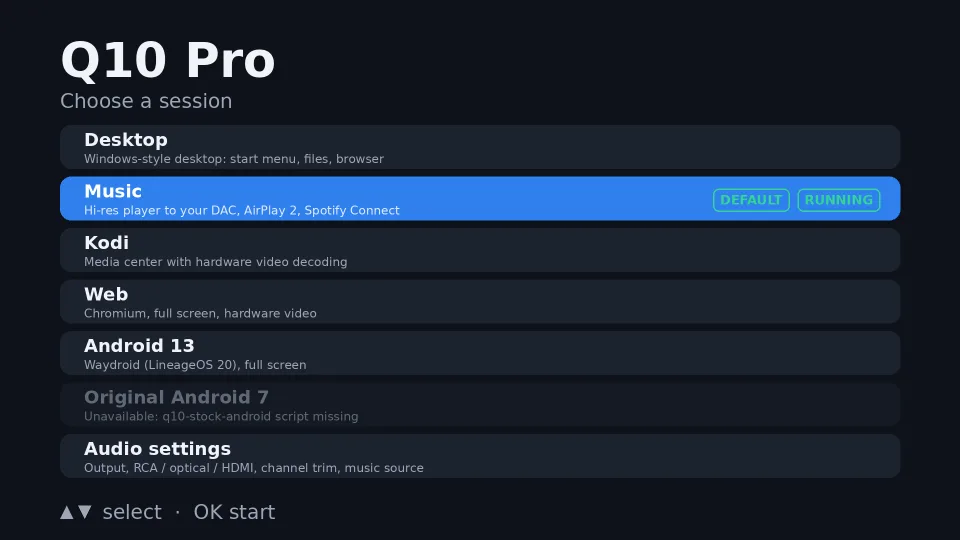
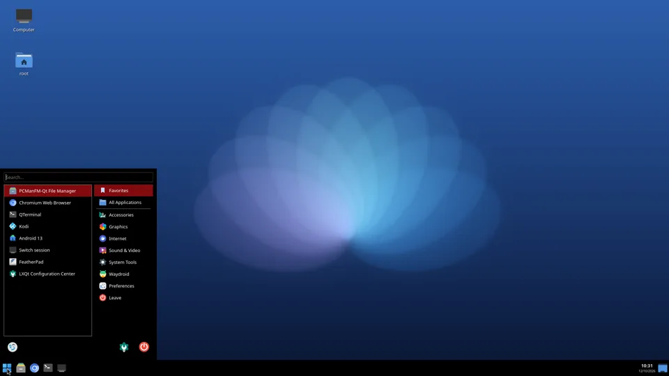
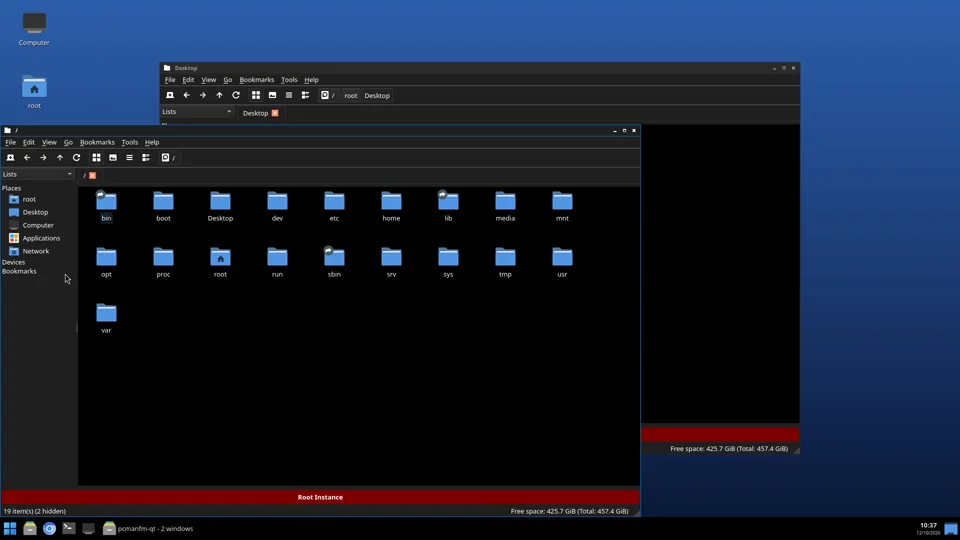
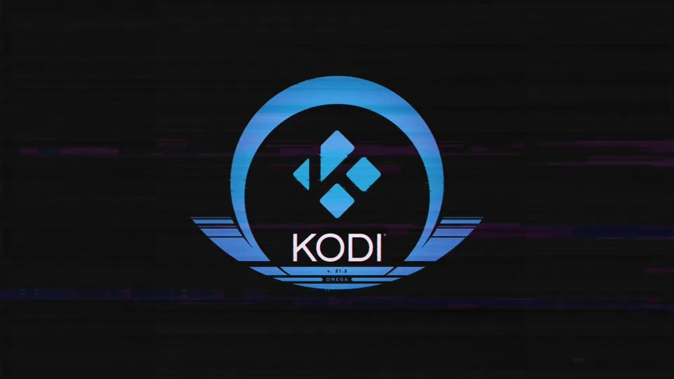
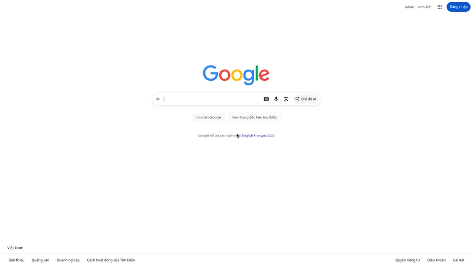
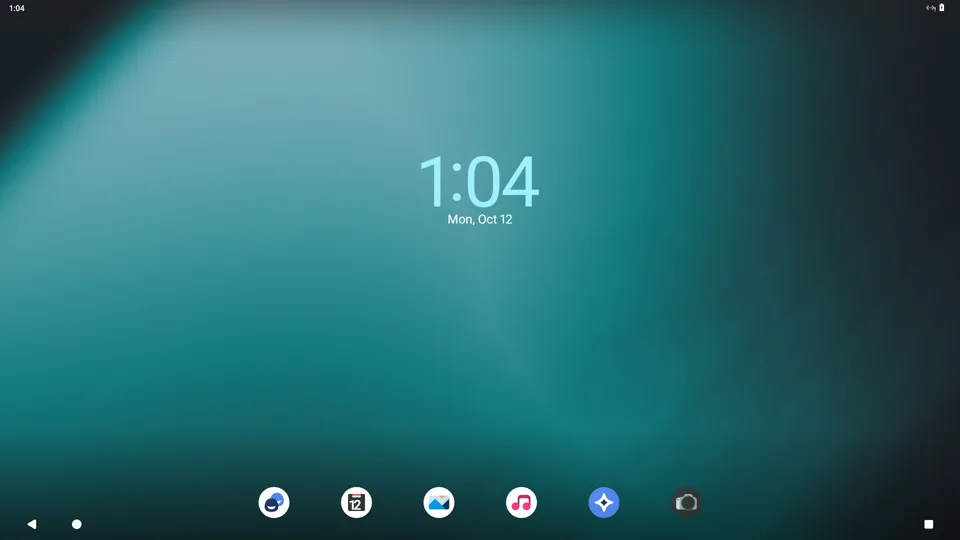
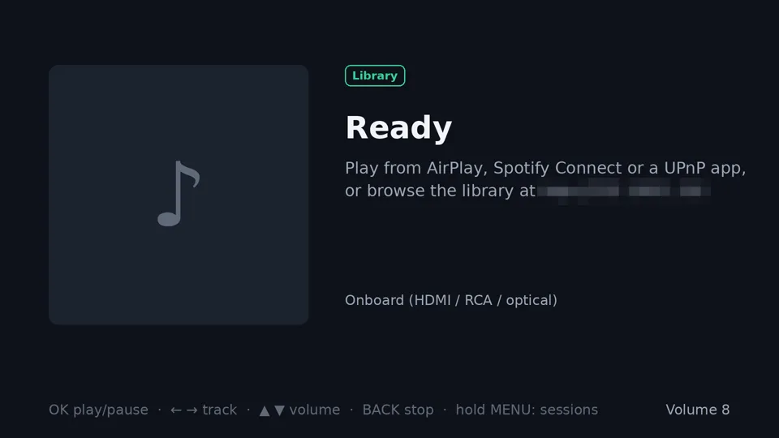
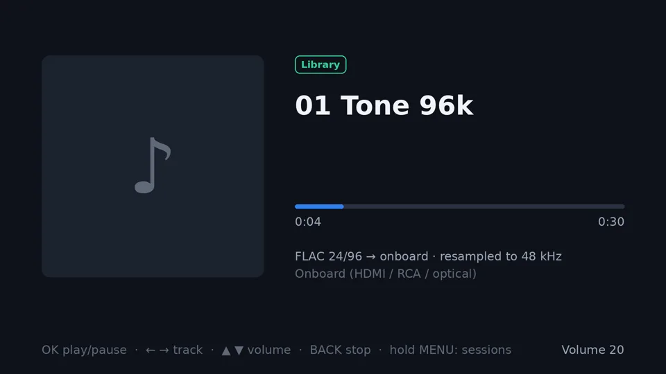
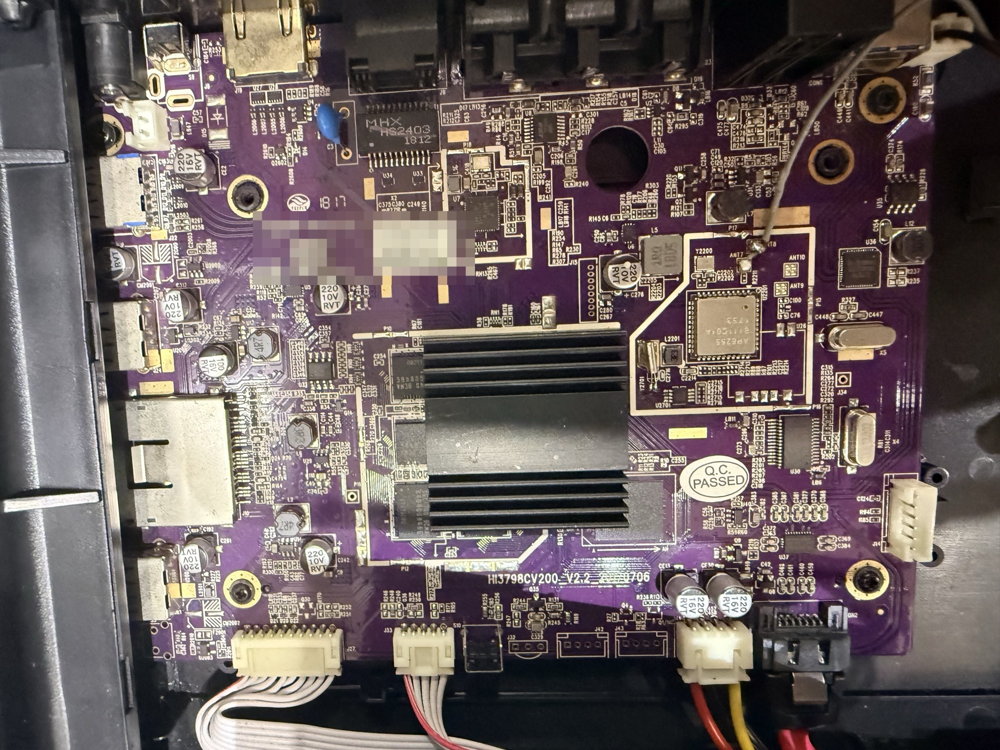

# HiMedia Q10 Pro on mainline Linux



Mainline **Linux 6.18** on the **HiMedia Q10 Pro** TV box (HiSilicon **Hi3798CV200**, 4× Cortex-A53,
2 GB RAM, 3.5" SATA bay), running **Debian trixie (armhf)**. The box was brought up with **no serial
console**. This repo holds what that took: the kernel patch series, the device tree, the build and
bring-up tools, the TV session switcher, and the research notes behind each step.

Every result below was measured on the box. Where a note only infers something, it says so.

## Screenshots

Captured from the box's own HDMI output (1080p, scaled down). Every screen below is mainline Linux on this box.

| | |
|---|---|
|  |  |
| **Desktop:** LXQt, GPU-accelerated through glamor, 293 MB in use | File manager (PCManFM-Qt), two windows, taskbar |
|  |  |
| **Kodi** 21.2 on GBM + GLES, V4L2-request hardware decode | **Web:** Chromium full screen on Wayland, video handed to a hardware mpv |
|  |  |
| **Android 13** (LineageOS 20 in Waydroid), launcher in 100 s from SATA | **Music:** AirPlay 2, Spotify Connect, UPnP, web library (LAN address pixelated) |
|  |  |
| Now playing: the screen says when the onboard 48 kHz path resamples | **GPU:** Panfrost on the Mali-T720, kmscube at 59.9 fps |
|  |  |
| **Hardware decode:** frame 150 of the test pattern, md5-identical to software | The board: Hi3798CV200 under the heatsink, AP6255 WiFi, SATA header (serial pixelated) |

## What works

| part | status | evidence |
|---|---|---|
| 4 CPU cores, DVFS | works | 396–1596 MHz, 840–1150 mV |
| Reboot | works | SP805 watchdog restart (mainline has no restart handler for this SoC) |
| Ethernet, WiFi | works | AP6255 after GPIO + 1.8 V pad fixes |
| USB 3 (side port) | works | 91.7 MB/s |
| Remote + front touch keys | works | one NEC keymap for both |
| Front VFD clock (TM1629A) | works | 16-segment font calibrated from photos |
| Display, GPU | works | VDP DRM driver, Panfrost (Mali-T720), kmscube 59.9 fps |
| Hardware video decode | works | H.264, HEVC (incl. Main10, 2160p), VP9, MPEG-2: md5-identical to software decode |
| Audio: RCA, optical, HDMI | works | small ALSA driver for the AIAO block |
| Audio: USB DAC | works | PCM to 32-bit/768 kHz and native DSD512, bit-perfect at the hardware |
| HDMI-CEC | send only | receive untested |
| SATA | works | root filesystem on the 3.5" disk (needs patch 0020, see below) |

A TV menu boots into **Desktop** (LXQt), **Music**, **Kodi** 21.2 (V4L2-request decode), **Web**
(Chromium with a hardware mpv bridge) or **Android 13** (LineageOS 20 in Waydroid).

Not working / not done: Android has no network (the kernel lacks policy routing); HDMI-CEC receive,
4K/HDR output and AC3 passthrough are untested; it is 32-bit only (AArch32 kernel on the A53s).
See [docs/](docs/) for the evidence and the open questions.

## Layout

```
scripts/himedia/
  kernel/arm32/     the patch series (0002-0020) against 6.18.55, board DTS, SoC dtsi, initramfs
  kernel/           build-tree helpers, DVFS / cpufreq / GPU tests
  build-kernel-arm32.ts, build-rootfs.ts, port-dtsi-arm32.ts   host-side builders (Bun)
  watch-boot.ts, find-box.ts, ramoops.ts, simulate-boot.ts      headless bring-up tools
  stub/             watchdog-reset stub: a console-less "did we get this far" signal
  audio/            q10_aiao: ALSA driver for the onboard audio (RCA, optical, HDMI)
  display/ vdp/ video/ cec/   display modes, VDP DRM, VDEC/VPSS, HDMI-CEC work and box tests
  session/          the TV session switcher and boot menu (Python)
  desktop/ kodi/ browser/ android/   the sessions' builds and installers
  rootfs-units/     systemd units for the box
  tools/            on-box helpers: SATA PHY tests, disk heat logging, framebuffer grab, backups
docs/               research notes (see docs/README.md), vendor GPL reference, board photos
```

## Before you start

- **Back up the eMMC first.** `bun run himedia:dump` reads every partition over adb from the stock
  Android and verifies each one by sha256 on both ends. The dump makes everything else reversible.
  Several partitions are **unique to your unit** (MAC, calibration, keys): keep the dump private,
  and never share it.
- **One write to the eMMC, and only one:** `bun run himedia:env --apply` changes the U-Boot
  environment so the loader tries a USB stick first and then falls through to the original eMMC boot
  (dry run by default; the dumped `bootargs.img` writes it back). After that, every experiment is a
  file on a stick. Pull the stick and the stock Android comes back. See
  `docs/261010-himedia-q10-pro-physical-runbook.md`.
- Without a serial console, bring-up uses a **watchdog ladder**: each stage arms the SP805 and spins,
  so "the box reset at second N" says how far it got (`docs/261010-himedia-boot-ladder-results.md`).
- SATA: mainline's combo-PHY driver writes a PCIe tuning value in SATA mode; the link then errs and
  resets under load. Patch `0020` writes the vendor's value before the first link training
  (`docs/261014-himedia-sata-kernel-vs-board.md`). Do not retune a link under a mounted filesystem.

## Configuration

The tools read these environment variables; the defaults suit a 192.168.1.0/24 home LAN.

| variable | default | used for |
|---|---|---|
| `Q10_HOST` | `root@q10.local` | ssh target of the box (mDNS name from avahi on the box) |
| `HIMEDIA_ROOT` | `~/himedia-q10-pro` | work dir: kernel trees, firmware dumps, build output (several GB) |
| `Q10_STATIC_IP` / `Q10_GATEWAY` | `192.168.1.56` / `192.168.1.1` | address baked into the kernel cmdline and rootfs for headless bring-up |
| `Q10_MAC` | `02:00:00:00:10:01` | the box's MAC, so `find-box` / `watch-boot` know it is the box replying |
| `Q10_ARP_CONTROLS` | `192.168.1.1` | hosts known to be up, used as a control for ARP checks |
| `Q10_ANDROID_IP` | `192.168.1.200` | stock Android's address for adb-based probes |
| `HIMEDIA_BRINGUP_IP` | `192.168.1.56` | the address `watch-boot` waits for |

The device tree pins a **locally administered placeholder MAC**; set your own if two boxes share a LAN.

## Build

Host: macOS or Linux with [Bun](https://bun.sh) and Docker (the kernel builds in an arm container).

```
bun run himedia:build-arm32 --out k26 --localversion k26     # kernel + DTB + modules into $HIMEDIA_ROOT
bun run himedia:rootfs                                        # Debian trixie armhf root
bun run test                                                  # unit tests (Bun + Python)
```

The long builds (kernel, Kodi, FFmpeg, mpv) take minutes to hours; run them in a tmux or screen window.

## Credits

- [HiSilicon-Development/linux-6.12.y](https://github.com/HiSilicon-Development/linux-6.12.y): the
  community VDEC/VPSS/VDP/HDMI drivers this port carries forward to 6.18 (GPL-2.0).
- [Kwiboo/FFmpeg](https://github.com/Kwiboo/FFmpeg) and Jonas Karlman's Kodi patches (V4L2 request).
- The vendor SDK kernel (GPL-2.0), read for register recipes; its defconfig and DTS are kept in
  `docs/vendor-arm32/` for reference.
- Panfrost / Mesa, Waydroid, LineageOS.

Field notes with photos: [olragon.com/garden/himedia-q10-pro-en](https://olragon.com/garden/himedia-q10-pro-en).

## License

GPL-2.0-only (see [LICENSE](LICENSE)), the same as the Linux kernel this extends. Third-party patches
keep their authors' headers.

Not affiliated with HiMedia or HiSilicon. You use this on your own hardware at your own risk.
